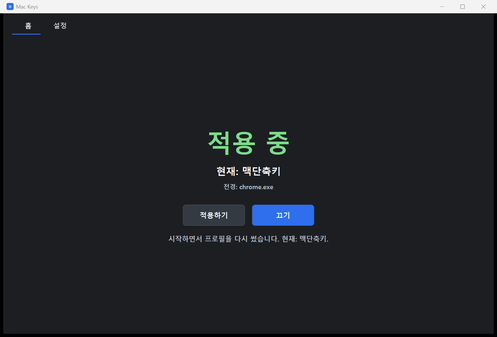
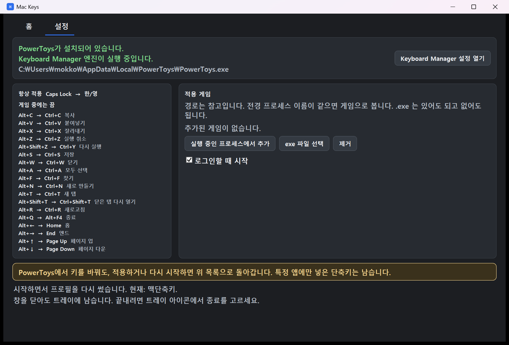

# Mac Keys

게임이 전경일 때 맥 단축키를 잠시 끄는 Windows 트레이 앱입니다. 키를 직접 가로채지 않고, PowerToys Keyboard Manager 프로필만 바꿉니다.



## 실행

.NET 8 SDK와 PowerToys가 필요합니다. Keyboard Manager는 켜 두어야 합니다.

```powershell
dotnet build src/MacKeys.App/MacKeys.App.csproj -c Release
src\MacKeys.App\bin\Release\net8.0-windows\MacKeys.exe
```

창을 닫아도 트레이에 남습니다. 끝내려면 트레이 아이콘에서 종료를 고릅니다.

PowerToys가 없으면 설정의 설치 버튼으로 `winget install --id Microsoft.PowerToys -e` 를 실행합니다.

## 상태

홈의 **적용하기** / **끄기**로 바꿉니다.

| 현재 | 언제 | 키 |
| --- | --- | --- |
| 맥단축키 | 적용 중이고, 등록한 게임이 전경이 아닐 때 | 아래 단축키와 Caps Lock → 한/영 |
| 게임 중(한영전환만) | 적용 중이고, 등록한 게임이 전경일 때 | Caps Lock → 한/영만 |
| 꺼짐(Windows) | 끄기 | 키를 바꾸지 않음 |

전경 창만 봅니다. 게임이 실행 중이어도 다른 창이 앞에 있으면 맥 단축키입니다. 프로세스 이름이 목록과 같으면 게임입니다. `.exe` 는 있어도 되고 없어도 됩니다. 이름은 같고 경로만 달라도 게임으로 봅니다. 권한 때문에 이름을 읽지 못하면 맥 단축키를 유지합니다.

종료할 때 켜져 있었으면 맥 단축키 프로필로 돌아갑니다. 꺼져 있었으면 꺼짐 그대로 둡니다.

## 설정



단축키 목록은 고정입니다. 오른쪽에서 게임을 추가합니다. 실행 중인 프로세스에서 고르거나 exe 파일을 고릅니다.

로그인할 때 시작은 기본으로 꺼져 있습니다. 설정에서 켤 수 있습니다.

PowerToys 편집기에서 키를 바꿔도, 이 앱을 적용하거나 다시 시작하면 위 목록으로 돌아갑니다. 특정 앱에만 넣어 둔 단축키는 일상 프로필에 남습니다.

### 항상 적용

Caps Lock → 한/영

### 게임 중에는 끔

| 입력 | 동작 |
| --- | --- |
| Alt+C | 복사 |
| Alt+V | 붙여넣기 |
| Alt+X | 잘라내기 |
| Alt+Z | 실행 취소 |
| Alt+Shift+Z | 다시 실행 |
| Alt+S | 저장 |
| Alt+W | 닫기 |
| Alt+A | 모두 선택 |
| Alt+F | 찾기 |
| Alt+N | 새로 만들기 |
| Alt+T | 새 탭 |
| Alt+Shift+T | 닫은 탭 다시 열기 |
| Alt+R | 새로고침 |
| Alt+Q | 종료 |
| Alt+← | 홈 |
| Alt+→ | 엔드 |
| Alt+↑ | 페이지 업 |
| Alt+↓ | 페이지 다운 |

왼쪽 Alt만 맥의 Command처럼 씁니다. 오른쪽 Alt, Alt+Tab, Windows 키 조합은 바꾸지 않습니다.

## 파일

이 앱의 게임 목록은 `%LOCALAPPDATA%\MacKeys\settings.json` 에 있습니다.

Keyboard Manager 프로필은 `%LOCALAPPDATA%\Microsoft\PowerToys\Keyboard Manager\` 의 `default.json`, `game.json`, `off.json` 입니다.

## 테스트

```powershell
dotnet test MacKeys.sln
```
